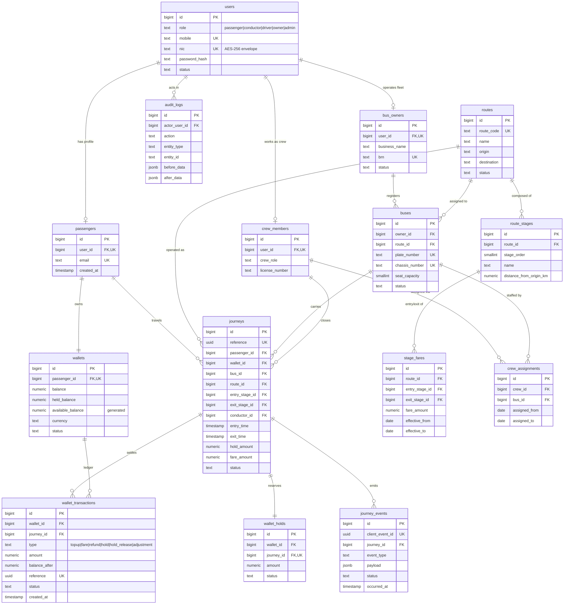

# TapRide - Initial Database Schema

Design artifact for **Issue #19 - Design Initial Database Schema** (milestone:
_Backend & Database Development_).

| Item | Value |
| --- | --- |
| Database | PostgreSQL 15+ (SRS 4.1.2) |
| Reference DDL | [`schema.sql`](./schema.sql) |
| Source of truth | Approved SRS, section 3 (FR-1 - FR-35) |
| Related issues | #18 (PostgreSQL + FastAPI integration), #25 (wallet operations) |

## 1. Scope

The initial schema covers the core entities requested in the issue:

- **passengers** and their authentication record (`users`)
- **wallets** and the wallet **ledger** (`wallet_transactions`)
- **buses** and their owner (`bus_owners`)
- **routes** with ordered stages and stage-to-stage fares
- **journeys** including maximum-fare holds and settlement

Supporting tables required by the SRS are included where a core table depends on
them: `crew_members` / `crew_assignments` (FR-22, FR-23), `wallet_holds`
(FR-10, FR-12), `journey_events` (FR-15 - FR-18) and `audit_logs` (FR-28, FR-30).

Deferred to later backend issues: receipts and email queue (FR-7, FR-34, FR-35),
manual cash tickets and exception workflow (FR-31, FR-33), settlement report
views (FR-24, FR-25).

## 2. Design principles

1. **Surrogate keys.** Every table uses `BIGINT GENERATED BY DEFAULT AS IDENTITY`
   as its primary key; natural keys (`users.mobile`, `users.nic`,
   `buses.plate_number`, `routes.route_code`) carry `UNIQUE` constraints.
2. **Idempotency by UUID.** Offline-safe records use a UUID that is generated on
   the client or by `gen_random_uuid()` (built into PostgreSQL 13+):
   `journeys.reference`, `journey_events.client_event_id`,
   `wallet_transactions.reference`.
   These back FR-16 and FR-18 (duplicate sync events are rejected, not
   double-processed).
3. **Money is `NUMERIC(12,2)`.** No floating point for balances or fares.
   All amounts are non-negative and in LKR.
4. **Timestamps are `TIMESTAMPTZ`.** Stored in UTC; `updated_at` is maintained by
   a trigger on the mutable tables.
5. **Balance model.** `wallets.balance` is the settled funds owned by the
   passenger. `wallets.held_balance` is the sum of active maximum-fare holds
   (FR-10). `available_balance` is a generated column
   (`balance - held_balance`) so FR-5 cannot drift from the ledger.
6. **State is explicit.** Lifecycle state lives in constrained `TEXT` columns
   rather than booleans, so journeys, wallets, buses and events can be audited.
7. **PII at rest.** `users.nic`, `users.mobile` and `passengers.nic` store an
   application-layer AES-256-GCM envelope (SRS 4.1.4). Password hashes are
   bcrypt/Argon2id; plaintext credentials are never stored.
8. **Referential integrity is enforced.** Core history tables use
   `ON DELETE RESTRICT` (`journeys`) so financial records cannot be orphaned;
   dependent rows use `CASCADE` (`wallets`, `wallet_transactions`).

## 3. Entity catalogue

| Entity | Purpose | Key attributes | SRS |
| --- | --- | --- | --- |
| `users` | Single identity for every role | `role`, `mobile`, `nic`, `password_hash`, `status` | FR-1, FR-2, FR-22, FR-29 |
| `passengers` | Passenger profile, wallet owner | `user_id` (1:1), `email`, `nic` | FR-1, FR-3 |
| `wallets` | Stored-value wallet | `passenger_id` (1:1), `balance`, `held_balance`, `available_balance`, `status` | FR-3, FR-5 |
| `wallet_transactions` | Append-only ledger | `type`, `amount`, `balance_after`, `reference`, `status` | FR-4, FR-6, FR-12 |
| `wallet_holds` | One maximum-fare hold per journey | `journey_id`, `amount`, `status` | FR-10, FR-12 |
| `bus_owners` | Fleet operator account and approval | `user_id`, `business_name`, `brn`, `status` | FR-20, FR-26 |
| `buses` | Registered vehicles | `owner_id`, `plate_number`, `chassis_number`, `route_id`, `seat_capacity` | FR-8, FR-20, FR-21 |
| `crew_members` | Conductor/driver profile | `user_id`, `crew_role`, `license_number` | FR-22 |
| `crew_assignments` | Crew to bus assignment periods | `crew_id`, `bus_id`, `assigned_from`, `assigned_to` | FR-23 |
| `routes` | Bus route definition | `route_code`, `name`, `origin`, `destination`, `status` | FR-27 |
| `route_stages` | Ordered stages on a route | `route_id`, `stage_order`, `name`, `distance_from_origin_km` | FR-27 |
| `stage_fares` | Stage-to-stage fare table (versioned) | `entry_stage_id`, `exit_stage_id`, `fare_amount`, `effective_from` | FR-11, FR-28 |
| `journeys` | Entry-to-exit ride record | `passenger_id`, `bus_id`, `entry_stage_id`, `exit_stage_id`, `status`, `fare_amount` | FR-9 - FR-14 |
| `journey_events` | Offline/online sync events (idempotent) | `client_event_id`, `event_type`, `payload`, `status` | FR-15 - FR-19 |
| `audit_logs` | Fare/admin change history | `actor_user_id`, `action`, `entity_type`, `before_data`, `after_data` | FR-28, FR-30 |

## 4. Relationships

| Relationship | Cardinality | Notes |
| --- | --- | --- |
| `users` -> `passengers` | 1 : 1 | Passenger role only; `passengers.user_id` is `UNIQUE` |
| `passengers` -> `wallets` | 1 : 1 | Wallet is provisioned on registration (FR-3) |
| `users` -> `bus_owners` | 1 : 1 | Owner role; requires admin approval (FR-26) |
| `bus_owners` -> `buses` | 1 : N | Fleet ownership (FR-21) |
| `routes` -> `route_stages` | 1 : N | Ordered by `stage_order` |
| `routes` x `route_stages` -> `stage_fares` | 1 : N | Composite FK prevents mixing stages from another route |
| `routes` -> `buses` | 1 : N | Current assignment; nullable for unassigned buses |
| `users` -> `crew_members` | 1 : 1 | Conductor/driver role, `UNIQUE user_id` |
| `crew_members` x `buses` -> `crew_assignments` | M : N | Assignment periods |
| `passengers` -> `journeys` | 1 : N | At most one open journey (partial unique index) |
| `wallets` -> `journeys` | 1 : N | Journey records the wallet used |
| `buses` -> `journeys` | 1 : N | Vehicle used for the trip |
| `journeys` -> `wallet_holds` | 1 : 1 | One hold per journey |
| `wallets` -> `wallet_transactions` | 1 : N | Append-only ledger |
| `journeys` -> `wallet_transactions` | 1 : N | Fare/hold/release entries reference the journey |
| `journeys` -> `journey_events` | 1 : N | Entry/exit events, including offline sync |
| `users` -> `audit_logs` | 1 : N | Actor of an administrative change |

## 5. ER diagram



## 6. Wallet and journey lifecycle

### 6.1 Balance rules

| Event | `balance` | `held_balance` | Ledger row |
| --- | --- | --- | --- |
| Top-up (FR-4) | `+ amount` | unchanged | `topup`, `completed` |
| Entry scan (FR-9, FR-10) | unchanged | `+ maximum_fare` | `hold`, `completed` |
| Exit scan (FR-11, FR-12) | `- actual_fare` | `- held amount` | `fare` + `hold_release` |
| Refund/adjustment | `+/- amount` | unchanged | `refund` / `adjustment` |

Every balance change is written in the same database transaction as its ledger
row, with the wallet row locked (`SELECT ... FOR UPDATE`) to prevent concurrent
scan races (SRS 4.1.4). `wallet_transactions.balance_after` is the settled
balance after the change and is used to reconcile the ledger against
`wallets.balance`.

### 6.2 Journey states

```text
initiated -> in_progress -> completed
     \            \
      \            -> pending_sync -> (sync) -> completed
       -> exception  (missed exit, disputed fare, failed sync)
```

- `initiated`: entry QR accepted, hold placed.
- `in_progress`: passenger is on board.
- `pending_sync`: offline exit recorded, awaiting sync (FR-14, FR-19).
- `completed`: fare settled, hold released, receipt available (FR-7, FR-12).
- `exception`: requires admin review (FR-33).

The partial unique index `uq_journey_open_per_passenger` prevents a passenger
from holding two open journeys, while still allowing unlimited completed
history.

## 7. Indexes and performance

| Index | Supports |
| --- | --- |
| `uq_journey_open_per_passenger` | Entry validation: at most one active journey per passenger |
| `idx_journeys_passenger_time` | Passenger journey history (FR-6) |
| `idx_journeys_bus_time` | Owner transaction reports by bus and date (FR-24) |
| `idx_wallet_tx_wallet_time` | Transaction history paging (FR-6) |
| `idx_wallet_tx_journey` | Receipt and settlement lookup (FR-7, FR-25) |
| `idx_journey_events_status` | Pending offline sync queue (FR-17, FR-19) |
| `idx_stage_fares_lookup` | Fare calculation at exit (FR-11) |
| `idx_crew_assignments_bus` | Conductor authorisation for a bus (FR-13, FR-23) |
| `idx_audit_entity`, `idx_audit_created` | Oversight and audit reporting (FR-28, FR-30) |

The schema targets 50 concurrent scans (SRS 4.1.1) by keeping the scan path to
short, indexed statements: lookup wallet, lock it, insert hold/ledger rows,
update the journey state.

## 8. Retention and archival (SRS 3.1.8)

| Data | Retention | Mechanism |
| --- | --- | --- |
| Wallet transactions | 12 months minimum | Append-only table; archive job later |
| Audit logs | Indefinite | Append-only table |
| Completed journeys | 90 days active, then archived | `journeys` + read-only reporting views |
| Pending offline events | 7 days before exception | `journey_events.status = 'pending'` aged by `occurred_at` |

## 9. Applying the schema

The DDL is a reference design and is safe to run on a clean database:

```bash
psql "$DATABASE_URL" -f docs/database/schema.sql
```

`.env` files are git-ignored; credentials are never committed. Connection
management for FastAPI is implemented in Issue #18 (`backend/database.py`).

## 10. Open questions for team review

1. Stage fares are versioned by `effective_from`; confirm the admin UI expects
   date-based fare history rather than a single mutable table (FR-28).
2. `held_balance` is modelled on the wallet and mirrored by `wallet_holds`.
   Confirm whether holds should survive a wallet suspension.
3. Receipts/email queue and manual cash tickets are deferred; confirm they can
   reuse `wallet_transactions` and `journey_events` rather than introducing new
   tables.
